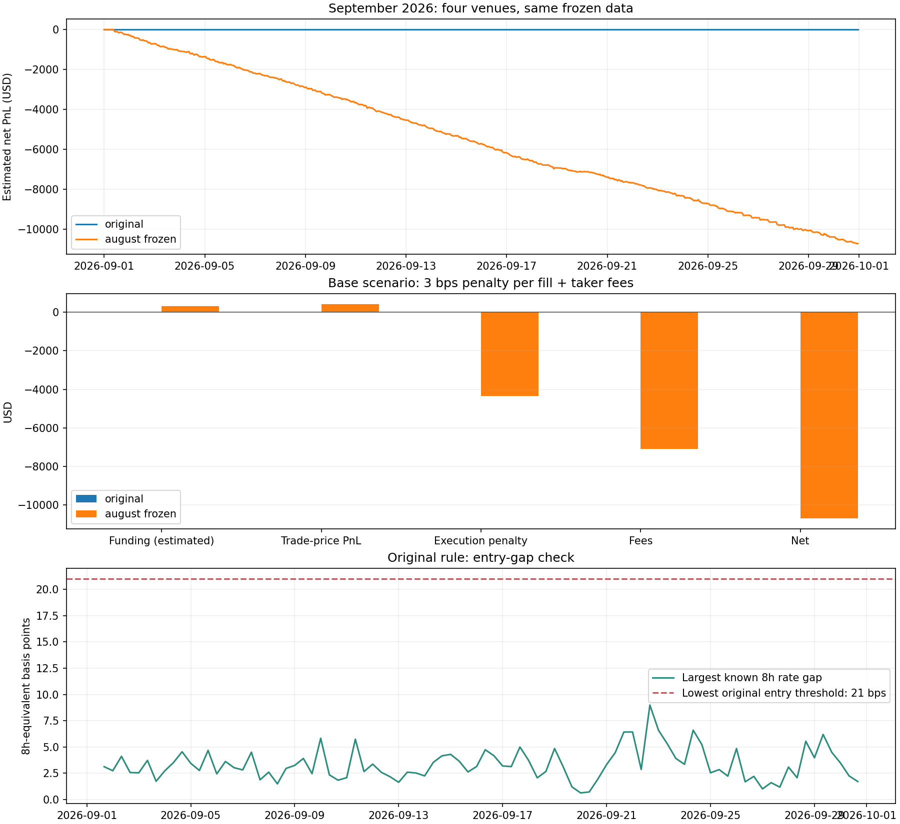
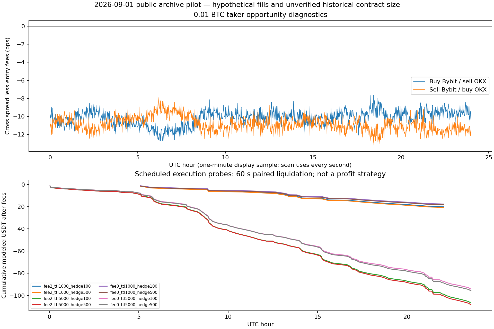
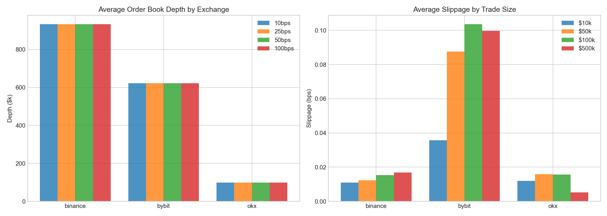
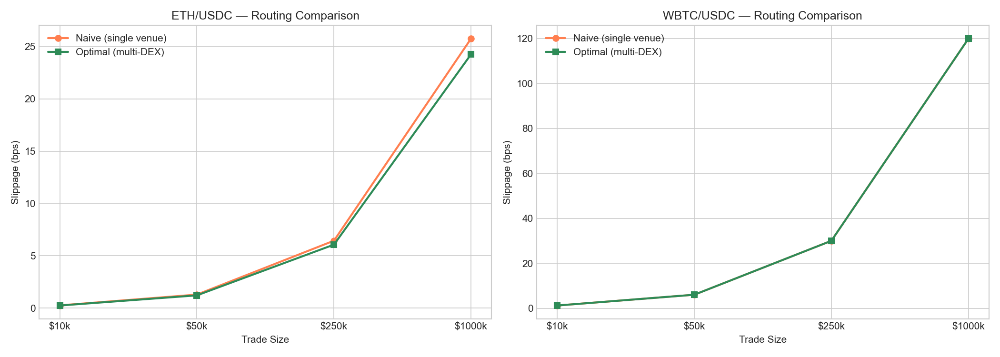
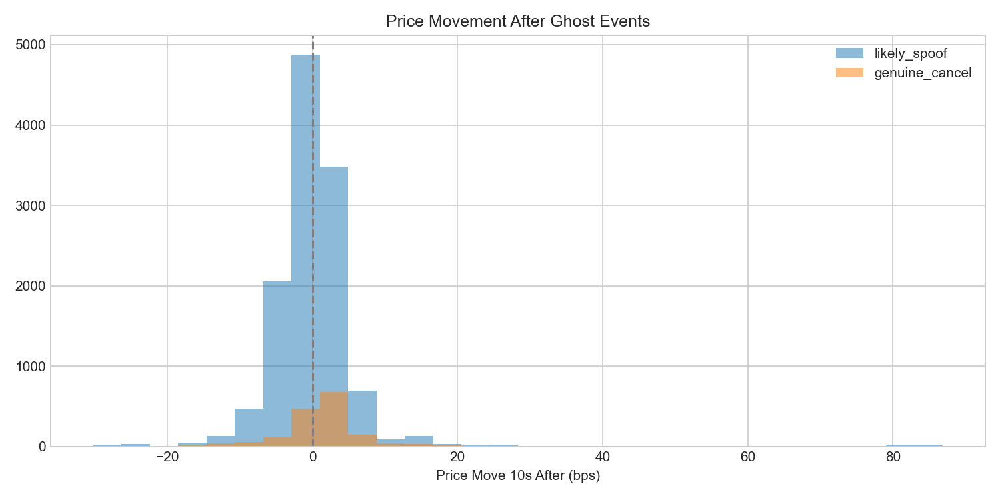

# Crypto Market Research

Python research on perpetual-futures funding, centralized-exchange order books, decentralized-exchange liquidity, and disappearing liquidity levels.

**The tested funding and execution rules have not established a profitable strategy after the stated costs.** Real market observations are combined with explicit execution and valuation assumptions; the results below are research estimates, with zero-trade outcomes retained.

## Findings after costs

| Study | Evaluation window (UTC, 2026) | Activity | Net result | Interpretation |
| --- | --- | --- | --- | --- |
| [Original September funding rule](funding/september/README.md) | September 1–30 | 0 trades | $0.00 | Known rate gaps do not reach the cost threshold. |
| [Lower-threshold funding comparison](funding/september/README.md) | September 1–30 | 387 trades | **Estimated −$10,701.46** | Funding +$333.16 and price PnL +$421.47 are outweighed by execution penalties −$4,351.18 and fees −$7,104.90. |
| [Cost-covering, low-turnover funding](funding/low_turnover/README.md) | September 15–30 | 0 trades in all three cost cases | $0.00 | Strongest conservative 72h forecast: 19.8168 bps; required costs plus buffer: 29/37/45 bps. |
| [Cost-filtered BTC taker/maker execution](execution/btc-2026-09-01/README.md) | September 1 | 0 qualifying entries | $0.00 | Best taker crossed spread: 7.7157 bps gross, −2.7841 bps after entry fees. |
| [Scheduled BTC maker probe](execution/btc-2026-09-01/README.md) | September 1 | 1,344 attempts; 75 complete pairs; 18 partial unwinds | **Estimated −$106.79** | Execution experiment: 0.01 BTC, 2 bps maker fee, 5s TTL, 100ms hedge latency. Its zero-maker-fee sensitivity still loses $94.21. |

The September funding comparison uses $100,000 initial capital, a 3 bps adverse penalty per fill and stated taker fees. Low-turnover tests use 1/3/5 bps penalties. Scheduled maker probes are separate hypothetical execution experiments; their sensitivity accounts must not be added together or treated as alpha. Windows and rules differ between studies, so the rows are not a controlled same-window ranking.

**Material limits:** September Hyperliquid funding amounts use a trade-price proxy because historical oracle data is missing. Hourly funding replays use candle-open execution proxies; the single-day execution study uses a 100ms book grid and an assumed queue model. Historical OKX contract value and actual account fee tiers remain unverified. September was already observed during development, and the single-day execution sample is not independent validation. Zero trades preserve modeled capital without demonstrating an income-producing strategy.

The earlier synthetic January–March $5,195.67 profit was superseded after finding terminal-snapshot look-ahead and Hyperliquid unit errors. Its replacement with real Binance/Bybit/OKX histories produces zero trades under the original rule; full historical four-venue predicted-rate coverage remains unavailable.

Research is organized into topic directories, with a frozen shared dataset and a separate execution-data pilot.

| Directory | Study | Included results |
| --- | --- | --- |
| [`funding/`](funding/) | Funding-rate differences across Binance, Bybit, OKX, and Hyperliquid | September four-venue shared-data strategy, causal signals, and costed trade ledgers |
| [`liquidity/`](liquidity/) | BTC order-book depth and stress across Binance, Bybit, and OKX | Slippage, recovery estimates, and resilience scores |
| [`dex/`](dex/) | ETH/USDC and WBTC/USDC liquidity fragmentation | Pool concentration and routing-cost comparisons |
| [`ghost/`](ghost/) | Large BTC liquidity levels and cancellation behaviour | Event labels, classification, and price-response analysis |

## Repository structure

```text
crypto-market-research/
|-- README.md
|-- RESULTS.md
|-- requirements.txt
|-- datasets/      # Frozen September four-venue shared data
|-- execution/     # Free BTC books/trades and single-day execution model
|-- funding/       # September strategies and earlier funding studies
|-- liquidity/     # Order-book depth, stress, and resilience
|-- dex/           # Pool fragmentation and execution routing
`-- ghost/         # Disappearing liquidity and price response
```

Each topic keeps its inputs and outputs together. File prefixes identify the study when downloading individual files.

## Shared data for subsequent research

Use [September 2026: one common four-venue dataset](datasets/2026-09/README.md) for new cross-venue comparisons. The UTC window is 1 September inclusive through 1 October exclusive. Its versioned manifest fixes the shared universe and data hashes; per-market coverage checks identify accepted inputs. Historical January–March and August studies remain separate samples.

The [September strategy replay](funding/september/README.md) now uses this exact frozen dataset. The original rule makes **0 trades**; the separately predefined lower-threshold comparison makes **387 trades**, with estimated net PnL **−$10,701.46** at 3 bps adverse execution penalty per fill plus taker fees. Hyperliquid funding notional is an explicit oracle-price estimate.

## Free execution-data pilot

[Bybit/OKX BTC, September 1 UTC](execution/btc-2026-09-01/README.md) adds freely downloaded price-level books and trades. Both markets cover all 1,440 minutes. Raw archives stay local; reproducible collectors, SHA-256 source hashes and validation reports are public. The [execution replay](execution/btc-2026-09-01/MODEL.md) finds no cost-filtered taker/maker entries. A separately scheduled 0.01 BTC maker probe loses an estimated $106.79 in its 2 bps maker-fee, 5 s TTL, 100 ms hedge scenario. The OKX archive lacks sequence/checksum fields, and hypothetical maker queue position remains a modeling assumption.

## Cost-covering low-turnover experiment

The [fixed-rule low-turnover funding study](funding/low_turnover/README.md) uses the same frozen September inputs, with September 15–30 chronological evaluation. All three cost scenarios make **0 trades**: the strongest consistent 72h forecast is **19.8168 bps**, below **29/37/45 bps** cost-plus-buffer requirements. No profitable entry was established.

## Results

[RESULTS.md](RESULTS.md) links the September shared-data strategy, earlier funding studies, and the other studies' result workbooks. PNG charts summarize the studies; CSV ledgers and workbooks retain detailed calculations and event records.

- September funding: the original rule takes **0 trades**. The fixed lower-threshold comparison takes **387 trades**, with estimated net PnL **−$10,701.46** at 3 bps execution penalty per fill plus fees. See [the shared-data strategy](funding/september/README.md).
- Earlier August funding: the original high-threshold rule takes **0 trades** on August data. The separate lower-threshold August comparison takes **109 trades** and returns **−$2,791.87** with 1 bp additional slippage per fill. See [methodology and reproduction](funding/README.md).
- January–March funding: a separate [actual-data replay](funding/jan_mar/README.md) covers Binance/Bybit/OKX and 15 common coins. The original 22–23 bps entry thresholds produce **0 trades**; the strongest known lagged-settlement gap is **10.9289 bps**. Historical predicted-rate observations and Hyperliquid hourly price/oracle coverage remain unavailable in this replay.
- Liquidity analysis: included workbook resilience scores are Binance 74.92, OKX 49.89, and Bybit 41.13. Scores depend on this sample and the implemented normalization.
- DEX analysis: Uniswap v3 accounts for 94.17% of ETH/USDC pool TVL and 100% of WBTC/USDC pool TVL in the included pool snapshot. The included model estimates 0.08 bps ETH routing savings at $50,000.
- Ghost-level backtest: 13,759 classified events, 53.1% signal win rate, and mean signal PnL of 0.38 bps before any unmodelled execution costs. Labels infer behaviour from public snapshots; participant identities and intent are unobserved.

## Plots

### September funding: shared four-venue data



The original rule stays flat. The pre-existing lower-threshold comparison earns an estimated $333.16 in funding but loses $10,701.46 after price PnL, execution penalties and fees. Read the [September methodology](funding/september/README.md) for causal signals and the missing-oracle valuation assumption. Earlier August and January–March studies remain linked separately.

### Cost-covering funding: forecast below the cost hurdle


All cost cases remain flat. The forecast-versus-cost panel explains why no entry qualifies; flat equity represents inactivity.

### BTC execution: fees and conservative maker probes



Cost-filtered entries do not qualify. Scheduled maker probes measure execution behavior under queue and latency assumptions; their negative net PnL includes modeled hedging and liquidation costs.

### Order-book depth and slippage



Compare visible BTC liquidity and estimated execution costs across the three exchanges. Results reflect the collected snapshots and the trade-size assumptions in `liquidity/liquidity_analysis.py`.

### DEX routing comparison



Compare modeled routing costs for ETH/USDC and WBTC/USDC. Estimates depend on the included pool snapshot and the liquidity assumptions in `dex/dex_analysis.py`.

### Price response around ghost events



Price-response analysis around disappearing large liquidity levels. Snapshot-based labels describe observed order-book behaviour; account identities and intent are unobserved.

## Run locally

Use Python 3.10 or newer. For an existing Conda environment:

```powershell
conda activate aqa2
python -m pip install -r requirements.txt
python funding/september/backtest.py
python funding/low_turnover/backtest.py
python -m unittest discover -s funding/september -p "test_backtest.py" -v
python -m unittest discover -s funding/low_turnover -p "test_backtest.py" -v
python liquidity/liquidity_analysis.py
python liquidity/liquidity_backtest.py
python dex/dex_analysis.py
python dex/dex_backtest.py
python ghost/ghost_analysis.py
python ghost/ghost_backtest.py
```

Each script reads and writes files beside itself. The September funding strategy reads the frozen shared dataset offline; detailed timing, oracle-proxy assumptions and reproduction instructions are in [funding/september/README.md](funding/september/README.md). Running an analysis or backtest updates its topic's workbooks and charts. Run analyses before their associated backtests. `*_fetch_*.py` scripts fetch fresh public market data, and `*_ws_collector.py` scripts collect new live snapshots; these require network access and may be subject to exchange restrictions.

## Data and interpretation

Current funding studies use the frozen September sample: 15 common coins across four venues, 43,200 hourly candles and 14,850 actual funding events. Signals use previously published settlements; original historical pre-settlement predictions are unavailable. The low-turnover study reserves September 1–14 as historical/development context and evaluates September 15–30. The input month was already examined, so this split does not establish an unseen holdout.

September Hyperliquid oracle history is missing: its funding cash uses an explicitly estimated trade-open notional. Binance settlement marks and Bybit/OKX hourly mark proxies are identified in the ledgers. The earlier August study separately includes archived oracle observations and fresh order-book prices; its assumptions must not be transferred to September.

The BTC execution pilot reconstructs freely downloaded Bybit/OKX books and trades for September 1. Large source archives stay local and are identified by hashes. Public market timestamps do not reconstruct local receipt latency or hypothetical queue position. OKX archive sequence/checksum fields are absent, and historical contract sizing remains an assumption. Margin fragmentation, liquidation, financing, stablecoin basis and full market impact are unmodeled.

The liquidity, DEX and ghost-level studies retain their original samples and model assumptions. Their diagnostic metrics are separate from the funding strategy results and do not establish executable net returns. Binary Word/PDF reports and development logs are omitted; [RESULTS.md](RESULTS.md) links each study's actual outputs.
