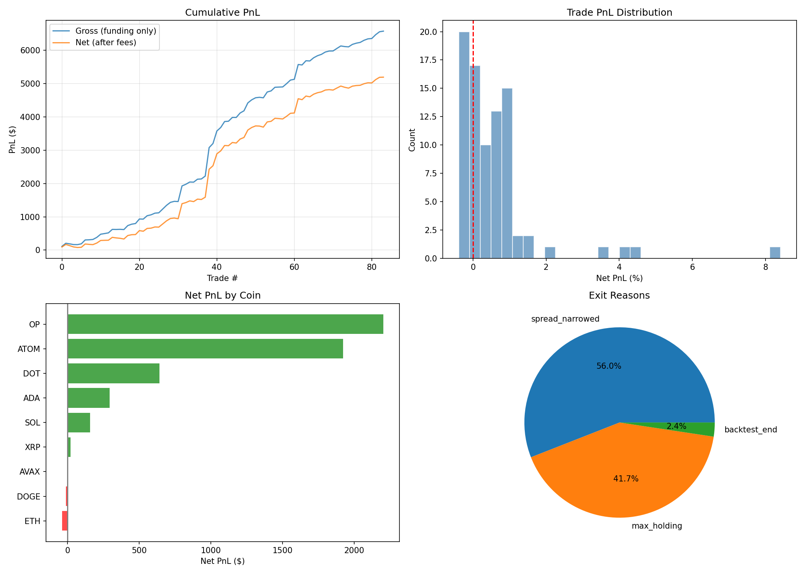

# Crypto Market Research

Python research on perpetual-futures funding, centralized-exchange order books, decentralized-exchange liquidity, and disappearing liquidity levels.

Research is organized into four topic directories. Each directory contains its Python source, datasets, charts, and result workbooks.

| Directory | Study | Included results |
| --- | --- | --- |
| [`funding/`](funding/) | Funding-rate differences across Binance, Bybit, OKX, and Hyperliquid | Fee-aware strategy simulation, funding spreads, and trade logs |
| [`liquidity/`](liquidity/) | BTC order-book depth and stress across Binance, Bybit, and OKX | Slippage, recovery estimates, and resilience scores |
| [`dex/`](dex/) | ETH/USDC and WBTC/USDC liquidity fragmentation | Pool concentration and routing-cost comparisons |
| [`ghost/`](ghost/) | Large BTC liquidity levels and cancellation behaviour | Event labels, classification, and price-response analysis |

## Repository structure

```text
crypto-market-research/
|-- README.md
|-- RESULTS.md
|-- requirements.txt
|-- funding/       # Funding rates, strategy, and simulated backtests
|-- liquidity/     # Order-book depth, stress, and resilience
|-- dex/           # Pool fragmentation and execution routing
`-- ghost/         # Disappearing liquidity and price response
```

Each topic keeps its inputs and outputs together. File prefixes identify the study when downloading individual files.

## Results

[RESULTS.md](RESULTS.md) contains tables extracted from the included Excel workbooks. The PNG files provide the original study charts. Excel workbooks retain detailed calculations and event records.

- Funding simulation: 84 trades and $5,195.67 net simulated PnL after $1,383 in fees. Binance history is observed; the other venues are simulated from snapshot offsets using seed 42.
- Liquidity analysis: included workbook resilience scores are Binance 74.92, OKX 49.89, and Bybit 41.13. Scores depend on this sample and the implemented normalization.
- DEX analysis: Uniswap v3 accounts for 94.17% of ETH/USDC pool TVL and 100% of WBTC/USDC pool TVL in the included pool snapshot. The included model estimates 0.08 bps ETH routing savings at $50,000.
- Ghost-level backtest: 13,759 classified events, 53.1% signal win rate, and mean signal PnL of 0.38 bps before any unmodelled execution costs. Labels infer behaviour from public snapshots; participant identities and intent are unobserved.

## Plots

### Funding strategy simulation



Fee-aware funding strategy results using observed Binance history and simulated histories for Bybit, OKX, and Hyperliquid (seed 42). The simulated net PnL is $5,195.67 across 84 trades.

### Order-book depth and slippage


Compare visible BTC liquidity and estimated execution costs across the three exchanges. Results reflect the collected snapshots and the trade-size assumptions in `liquidity/liquidity_analysis.py`.

### DEX routing comparison


Compare modeled routing costs for ETH/USDC and WBTC/USDC. Estimates depend on the included pool snapshot and the liquidity assumptions in `dex/dex_analysis.py`.

### Price response around ghost events


Price-response analysis around disappearing large liquidity levels. Snapshot-based labels describe observed order-book behaviour; account identities and intent are unobserved.

## Run locally

Use Python 3.10 or newer. For an existing Conda environment:

```powershell
conda activate aqa2
python -m pip install -r requirements.txt
python funding/funding_analysis.py
python funding/funding_backtest.py
python liquidity/liquidity_analysis.py
python liquidity/liquidity_backtest.py
python dex/dex_analysis.py
python dex/dex_backtest.py
python ghost/ghost_analysis.py
python ghost/ghost_backtest.py
```

Each script reads and writes files beside itself. Running an analysis or backtest updates its topic's workbooks and charts. Run analyses before their associated backtests. `*_fetch_*.py` scripts fetch fresh public market data, and `*_ws_collector.py` scripts collect new live snapshots; these require network access and may be subject to exchange restrictions.

## Data and interpretation

This export consolidates the four local answer packs. Each topic retains its own observations, candle context, and historical window. The order-book CSVs include the supplied REST and streaming samples. Candle histories provide price context at a different sampling frequency. File timestamps, workbook rows, and collection code should be used to assess the exact sample.

Funding results include synthetic histories for three venues. DEX routing uses the assumptions implemented in the supplied pool model, including estimated liquidity. Public order-book snapshots provide limited evidence about fills, cancellations, queue position, and intra-snapshot events. Historical and simulated results describe these samples and assumptions.

Binary Word/PDF reports and development logs are omitted from this code-and-results export. The workbook-derived summary provides the public results narrative.
