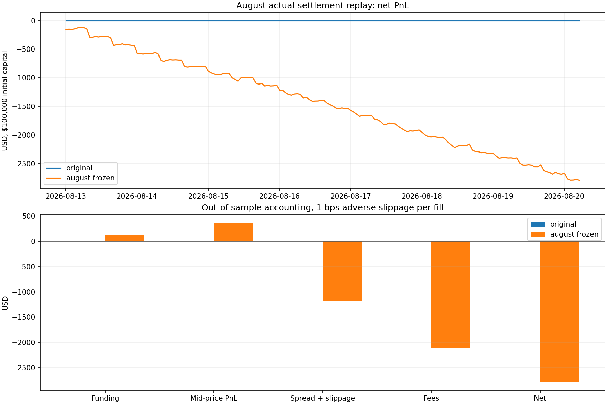

# Funding research

[Cost-covering low-turnover study](low_turnover/README.md): fixed72h forecast and transaction-cost hurdle, September15–30 evaluation. Zero qualifying entries in all cost scenarios. [繁體中文](low_turnover/README.zh-TW.md).

The current [September four-venue strategy](september/README.md) runs on the frozen shared one-month dataset. [繁體中文九月說明](september/README.zh-TW.md).

## Earlier August funding-rate replay

[繁體中文：資料、策略及重現方式](README.zh-TW.md)

[January–March actual-data replay](jan_mar/README.md): Binance/Bybit/OKX, 15 common coins, past settled-rate signals, original entry thresholds. This separate study returns zero trades and documents the limits of four-venue comparability.

This study uses the live observations collected on 11–20 August 2026 and actual funding settlements downloaded from Binance, Bybit, OKX and Hyperliquid. All times are UTC. The earlier January–March synthetic-history simulation is superseded because it reused a terminal snapshot and mishandled Hyperliquid units.

## Reproduce

From the repository root, with Python 3.10+:

```powershell
python -m pip install -r requirements.txt
python funding/august_backtest.py
python -m unittest discover -s funding -p "test_august_backtest.py" -v
```

The replay runs offline from the two included CSVs. To refresh actual outcome histories with the public API downloader:

```powershell
python funding/august_fetch_settlements.py
```

The downloader uses included observations for contract identity and records endpoint coverage, timestamp ranges, request settings and file hashes in `august_settlement_fetch.json`. API retention and listings can change; the included CSV is the reproducible baseline.

 Rebuilding the compact observation CSV requires the original JSONL archive:

```powershell
python funding/august_prepare_data.py --archive /path/to/archive
```

The archive itself contains several gigabytes of observations. Its relative file paths and SHA-256 hashes are recorded in `august_observations_manifest.json`. The public CSV preserves the actual receipt/observation timestamps, raw rates, target settlement timestamps, relevant book levels, and selection roles. The output is an exact hourly subset, with no synthetic cross-venue histories or interpolated rates.

## Reproduced results

| Strategy | Trades | Funding | Mid-price PnL | Spread + slippage | Fees | Net |
| --- | ---: | ---: | ---: | ---: | ---: | ---: |
| original | 0 | $0.00 | $0.00 | $-0.00 | $-0.00 | $0.00 |
| august_frozen | 109 | $123.21 | $370.75 | $-1,177.78 | $-2,108.06 | $-2,791.87 |

Initial capital: $100,000. Additional adverse slippage: 1 bp per fill, on top of observed bid/ask spreads and taker fees. Evaluation decisions: 13 August 00:00 to 20 August 05:00 UTC, 2026.

[Full results and sensitivity scenarios](august_results.json), [original-rule decisions](august_original_decisions.csv), [comparison trades](august_frozen_trades.csv), and [comparison hourly equity](august_frozen_equity.csv).



## Data and time separation

- Observation window: hourly decisions from 11 August 11:00 through 20 August 05:00. An early collection outage is retained as missing data.
- Development/warm-up: decisions before 13 August 00:00. Contract intervals become known through observed target-settlement transitions.
- Evaluation: 13 August 00:00 through 20 August 05:00, with final liquidation using the recorded execution books after that decision.
- This date split existed in the earlier local research. The evaluation is a chronological replay of previously available data, so it does not establish a newly unseen holdout.
- The tradable venue/base universe is frozen from execution books received before 13 August. Binance and Hyperliquid MKR/TON have no such books and are excluded. The downloader also records unavailable Binance MKR/TON settlements explicitly.
- Each decision uses the latest funding observation received within the preceding five minutes. CEX intervals are inferred from previously observed target changes; the observed four-hour contracts are handled individually. Hyperliquid stores one-hour rates explicitly.
- Signals compare `raw_rate * 8 / interval_hours`. This normalized rate is used for ranking only. Funding cash flows always use the raw rate at an actual settlement event.
- Endpoint histories are outcome data. Their future values and inferred intervals are never supplied to signal selection.

## Strategy variants

The `original` variant preserves the earlier strategy's economic thresholds: every eight hours, choose the largest positive normalized funding difference for each coin, long the lower-rate venue and short the higher-rate venue. Enter only when the eight-hour spread exceeds both legs' full round-trip taker fees plus 2 bps. Close at an eight-hour decision when the spread falls below 0.5 bps, or after 48 hours. Final liquidation is imposed at sample end.

The `august_frozen` comparison uses the pre-existing local August rules: hourly ranking, up to five coins, entry at 3 daily bps (1 bps per eight hours), minimum hold eight hours, then exit below 1 daily bp, outside the top five, or after the preferred venue pair changes. Both variants have a 48-hour holding cap. This lower entry threshold is a separate strategy assumption; it is not presented as the original strategy's result.

Both variants use $100,000 initial capital, up to $10,000 per leg, five concurrent pairs, and a $1,000 allocation reserve. Each pair uses equal base quantities across venues. Portfolio size is constrained by available gross cash allocation after realized PnL, current liquidation-value PnL, entry fees and the allocation reserve. Symbols with different base units, such as PEPE and 1000PEPE, remain distinct.

## Cash flows and execution

A long leg pays `quantity * settlement_reference_price * raw_settled_rate`; a short leg receives the same expression. Hyperliquid uses its archived spot oracle price, matching its [funding specification](https://hyperliquid.gitbook.io/hyperliquid-docs/trading/funding). Payments occur only after that leg's entry fill and on or before its exit fill. Actual settlement mark prices are used when the endpoint supplies them. Otherwise the valuation is the latest archived mark or book midpoint within five minutes before the event; Hyperliquid specifically requires a fresh archived oracle price. These observations precede the exact settlement instant and therefore remain explicitly identified notional estimates.

Signals are followed by a delay of at least 60 seconds. Each leg uses its first observed book between 60 and 180 seconds after the decision. Buys cross the ask and sells cross the bid. Historical queue fills are not assumed. Fees per fill are fixed scenario inputs: Binance 5 bps, Bybit 5.5 bps, OKX 5 bps and Hyperliquid 4.5 bps. These are conservative illustrative taker assumptions, not verified account-specific fee tiers. Additional adverse slippage is replayed at 0, 1 and 3 bps per fill.

Price PnL is calculated on fixed base quantities using entry and exit prices for both legs. Reports separate funding PnL, midpoint price PnL, spread/slippage cost, trading fees and final net PnL. Unrealized positions are marked hourly to observed bid/ask with scenario exit slippage and prospective exit fees, and included in the equity curve as estimated liquidation value. Missing settlement coverage, unavailable settlement valuation and missing open-position valuations cause explicit errors rather than zero-filled outcomes.

## Limits

Execution uses observed quotes plus a slippage scenario. Full depth-dependent impact, queue dynamics, actual fills, lot rounding and historical contract constraints remain unmodelled. The per-fill timestamps can differ across venues; legging risk is reflected only through the observed fill prices. Funding notional fallback marks are estimates rather than account receipts. USD, USDT and USDC are treated at parity. Venue-specific margin, liquidation, capital transfers, insolvency and stablecoin depegs are outside this replay. Capital allocation is constrained, but exchange margin mechanics are not simulated. The sample is short and supports no annualized performance claim.
