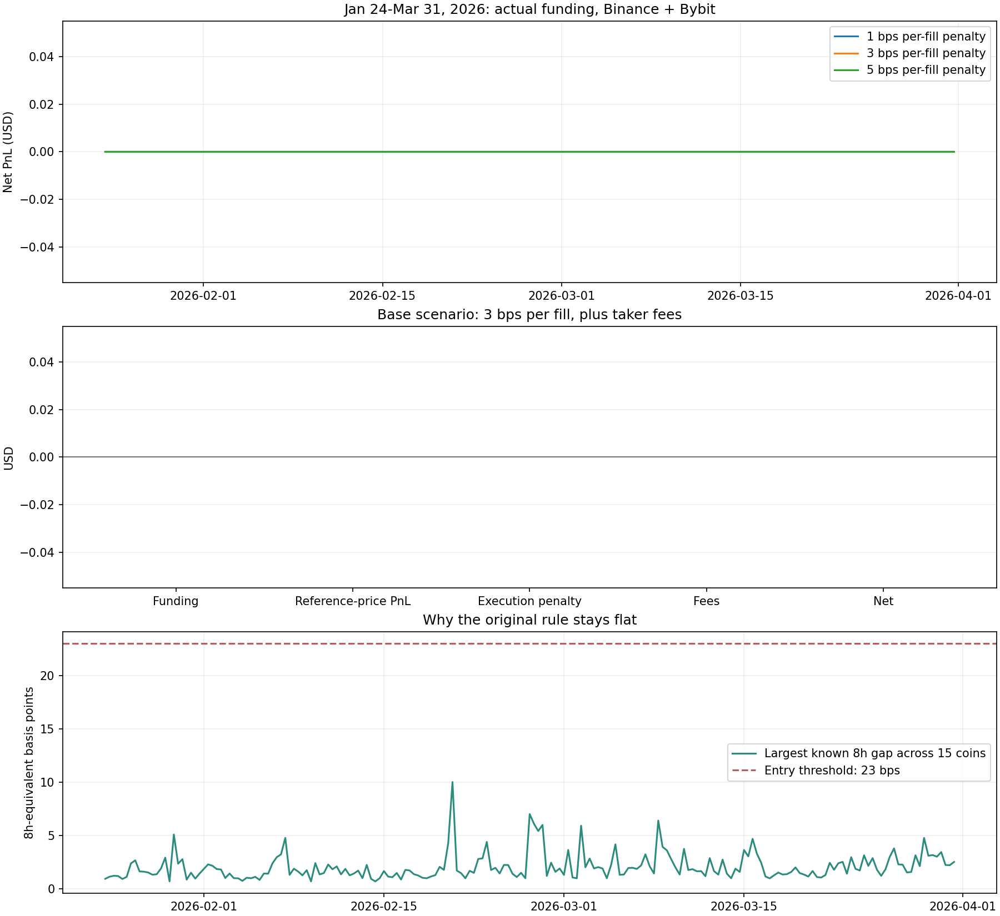

# 2026 年 1–3 月：真實資料重現

已完成可驗證的 Binance／Bybit 版本，期間為 **2026-01-24 08:00 至 2026-03-31 16:00 UTC**。

原本 $5,195.67 的盈利來自四交易所的合成歷史及費率單位錯誤；這次保留原策略門檻，讓真實資料決定結果。

## 結果

- 初始資金 $100,000。
- 使用 15 個共同幣種，合共 2,985 次幣種／決策比較。
- 最大的當時可知費率差：**10.0222 bps／8 小時**。
- 原策略入場門檻：**超過 23 bps／8 小時**，包括 Binance／Bybit 雙邊開平倉的 21 bps 手續費，再加 2 bps。
- 因此 **0 筆交易、淨損益 $0**。1／3／5 bps 的額外成交成本情境均相同。



## 資料與訊號

兩間交易所共下載 **6,417 筆實際結算資料**和 **48,030 筆每小時成交／標記價格配對**。每個可用合約有 1,601 個價格時點，從 1 月 24 日 00:00 起；結算資料從 1 月 22 日開始，供策略暖機使用。

15 個共同幣種為 ADA、ARB、ATOM、AVAX、BNB、BTC、DOGE、DOT、ETH、LINK、LTC、OP、SOL、UNI、XRP。MATIC 在 Binance 缺乏成交 K 線、Bybit 無觀察值，故排除，沒有改用 POL。

當時的「結算前預估費率」快照沒有保存在這份資料中，因此訊號採用決策前至少五分鐘已結算的最新費率。五分鐘是公布延遲假設；缺乏當時實際收到 API 回應的時間。換算週期只根據當時已知的前兩次結算，歷史未來數值不參與入場。

每 8 小時檢查一次。同幣種在較低費率交易所做多、較高費率交易所做空，兩邊幣數相同；入場門檻保留 23 bps。費率差低於 0.5 bps 或持有滿 48 小時退出。決策後下一小時才按歷史成交 K 線開盤價加成本假設估算成交。價格是代理值，沒有假造當時買賣盤。

這個版本回答的是：**兩間可驗證交易所，使用已公布結算資料，原門檻在這段期間會怎樣。** 四間交易所完整組合，以及使用當時預估費率的原訊號，仍需要更完整的資料才能評估。舊模擬盈利沒有在這個真實資料版本中重現。

## 重跑

```powershell
python funding/jan_mar/backtest.py
python -m unittest discover -s funding/jan_mar -p "test_backtest.py" -v
```

[英文完整方法](README.md)、[所有決策](decisions.csv)、[結果](results.json)、[資料下載來源與雜湊](provenance.json)。資料和程式支援離線重跑。
