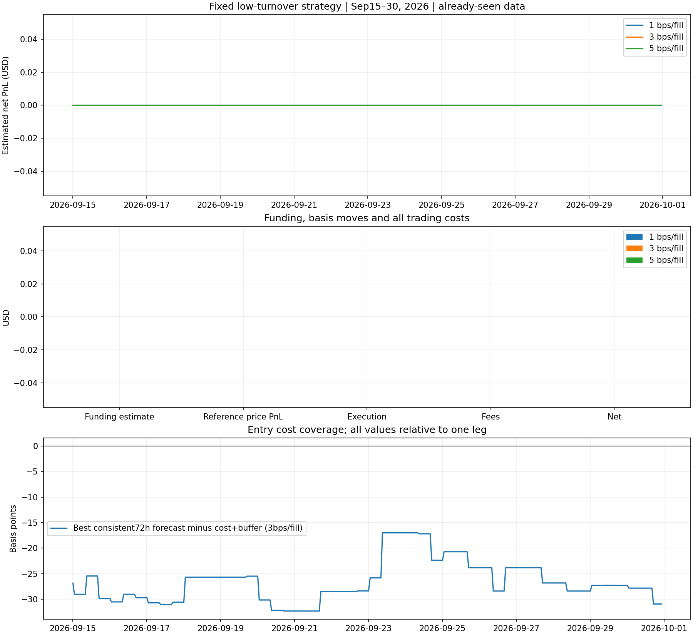

# 低換手、成本覆蓋的資金費策略

全程使用同一份固定的九月四交易所、15 幣種資料：`crypto-perpetuals-2026-09-v1`。先訂規則再執行，沒有按九月淨利搜尋最好門檻。

## 結果

三個成本情境都 **0 筆交易、$0 損益、$0 手續費**，期末資金維持 $100,000。最強的一致性訊號是 **9 月 24 日 09:00 UTC，Bybit 做多 UNI／Hyperliquid 做空 UNI**，九個歷史區段均為正。

| 每次成交額外成本 | 預估 72 小時收益 | 該配對成本＋緩衝 | 不足金額 |
| --- | ---: | ---: | ---: |
| 1 bp | 19.8168 bps | 29 bps | 9.1832 bps |
| 3 bps | 19.8168 bps | 37 bps | 17.1832 bps |
| 5 bps | 19.8168 bps | 45 bps | 25.1832 bps |

這個版本避免了低門檻規則的頻繁付費，但尚未找到收益足以支付成本的入場。先前 387 筆版本使用整個九月，這次從 9 月 15 日開始，規則亦不同；不能把兩者當成同視窗的嚴格對照。

**24 項獨立測試全部通過**，包括未來資料隔離、跨週期費率加總、結算歸屬、成本、持有與冷卻規則。當未來收益剛好等於退出成本時，不會單因相等而退出。



[完整結果](results.json)、[逐次預測與拒絕理由](decisions.csv)、[每小時淨值](equity.csv)、[交易](trades.csv)、[付款](payments.csv)。決策 CSV 約 91 MB，建議下載分析；沒有達標交易時，交易與付款檔只有欄位標頭。

## 固定規則

- 9 月 1–14 日保留作歷史與開發背景；評估從 **9 月 15 日 00:00**空倉開始，到 **9 月 30 日 23:00 UTC**全部平倉。由於已看過整月資料，這是按時間分段的開發評估，尚未構成全新獨立樣本。
- 每次只讀取過去 **九個完整 8 小時區段，共 72 小時**。Hyperliquid 每段累加八次每小時費率，中央交易所每段一次；原始費率保持單次結算單位。
- 區段結束加五分鐘後才可使用，避免把尚未知道的資金費讀入預測。
- 每個交易所配對、方向，要求九段之中至少八段費率差為正。以費率差的 **下四分位數乘九**，保守預估未來 72 小時收益。
- 預估收益必須高於完整雙邊來回手續費、四次執行成本，再加 **5 bps 餘額**。剩餘資料若不足完整 72 小時預測範圍，不開新倉。
- 至少持有 **24 小時**；之後若未來 24 小時預估資金費不足以覆蓋剩餘平倉成本再加 2 bps，或預測連續三次反向，就退出。最長持有 **七天**。
- 不因其他配對排名稍好就換倉；同幣種平倉後 **24 小時冷卻**，避免來回支付費用。

## 執行、成本與資料限制

初始資金 $100,000，每邊目標上限 $10,000，最多五組，兩邊使用相同幣數。資金分配保留 $1,000 餘額，並考慮持倉估計平倉價值；尚未建立交易所個別保證金與清算模型。

每次成交 taker 費用假設：Binance 5 bps、Bybit 5.5 bps、OKX 5 bps、Hyperliquid 4.5 bps。另測試 **1／3／5 bps** 額外執行成本。決策後下一小時成交 K 線開盤作價格代理；沒有假造歷史買賣盤。

實際結算費率決定持倉付款。Binance 使用結算標記價格，Bybit／OKX 使用該小時歷史 mark 開盤。Hyperliquid 缺歷史 oracle，因此以成交開盤價作明列的名目本金代理，資金費金額及淨損益仍屬估算。

這個模型的預測不保證費率差會持續，也不代表基差風險消失。零交易可能是合理結果，應一起檢視被拒的收益預測與成本差額。

## 重跑

```powershell
python funding/low_turnover/backtest.py
python -m unittest discover -s funding/low_turnover -p "test_backtest.py" -v
```

輸入保持固定，程式記錄資料及程式雜湊。完整參數與限制見 [英文方法](README.md)。
